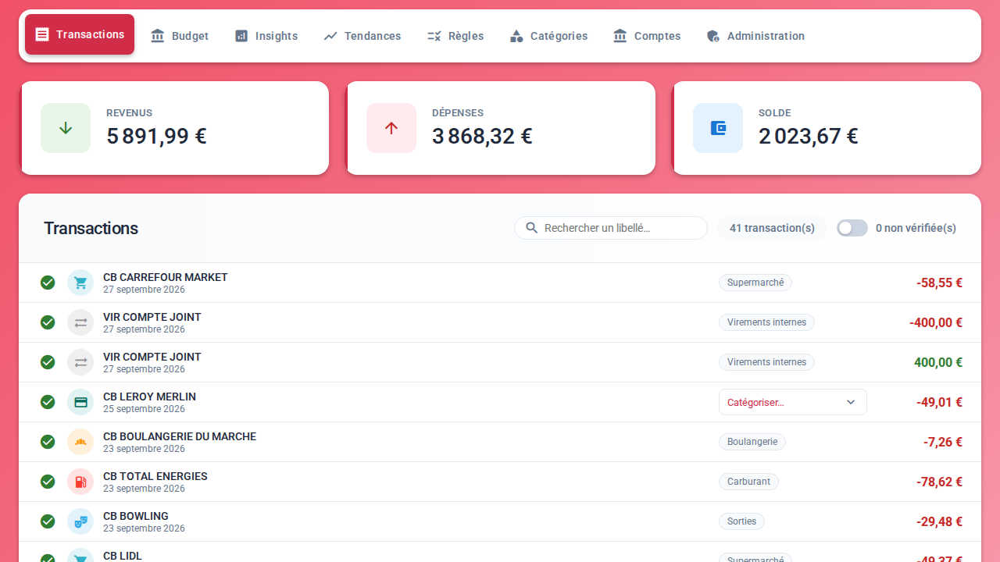

# Carbure for YunoHost

[Carbure](https://carbure.org) packaged for [YunoHost](https://yunohost.org): a self-hosted
household budget manager, with automatic bank synchronization ([woob](https://woob.tech/)),
categories, budgets, trends, and [iPhone](https://apps.apple.com/fr/app/carbure/id6824057363)
and [Android](https://play.google.com/store/apps/details?id=org.carbure.app) apps.

*[Lire en français](README_fr.md)*



## Install

```bash
sudo yunohost app install https://github.com/ltoinel/carbure_ynh
```

Carbure needs a domain of its own. Read [doc/PRE_INSTALL.md](doc/PRE_INSTALL.md) first;
the administration is described in [doc/ADMIN.md](doc/ADMIN.md).

## What the package does

- Carbure in `/var/www/<app>`, served by nginx and PHP-FPM (PHP 8.4, MariaDB).
- Its data (configuration, logs, woob with the banks) in `/home/yunohost.app/<app>`.
- Installed without the web wizard by `tools/install.php` of Carbure: schema, starter
  categories, rules and insights, the chosen YunoHost user as administrator.
- woob in a virtualenv, rebuilt at each upgrade; migrations applied at each upgrade.
- Daily synchronization of every account (cron).

## Status

Work in progress, not yet in the YunoHost catalog. It needs Carbure 1.10.0 (the first
release with `tools/install.php`). Tested with
[package_check](https://github.com/YunoHost/package_check): not yet.

## Links

- Carbure: <https://github.com/ltoinel/Carbure> · documentation <https://carbure.org>
- Report a bug of the package: <https://github.com/ltoinel/carbure_ynh/issues>
